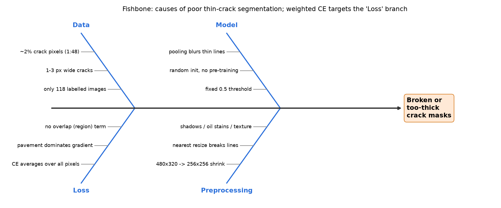
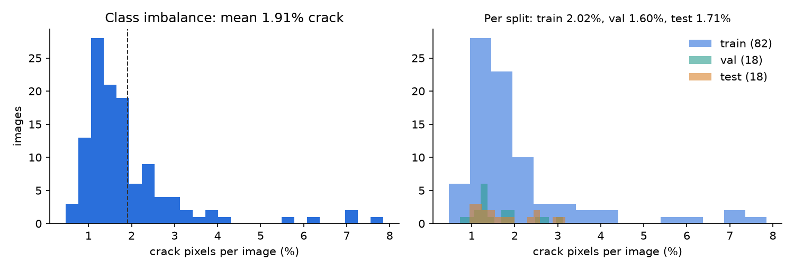
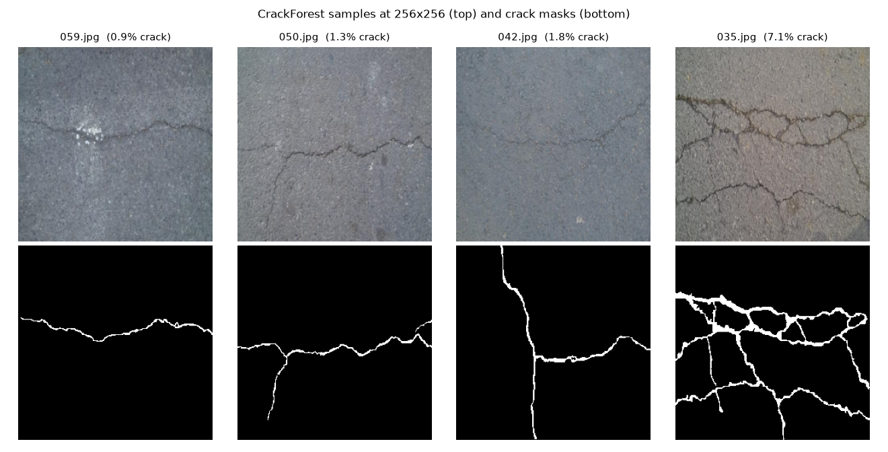
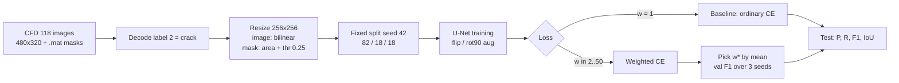
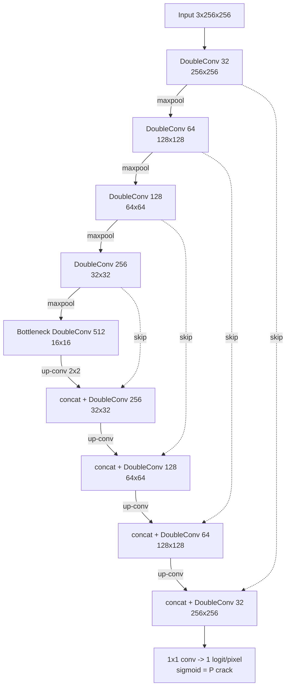
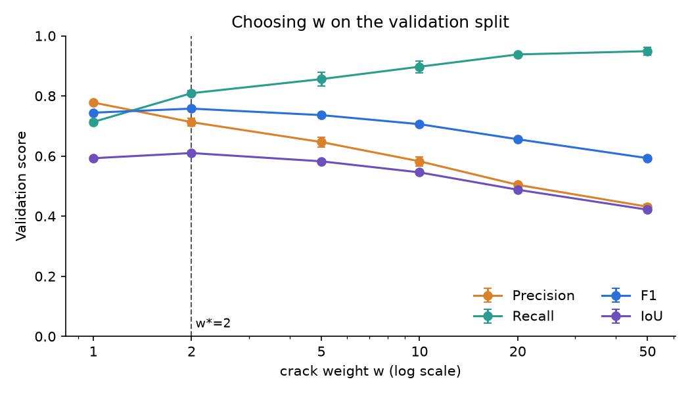
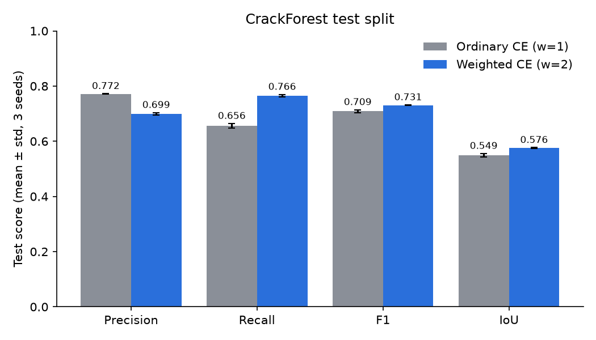
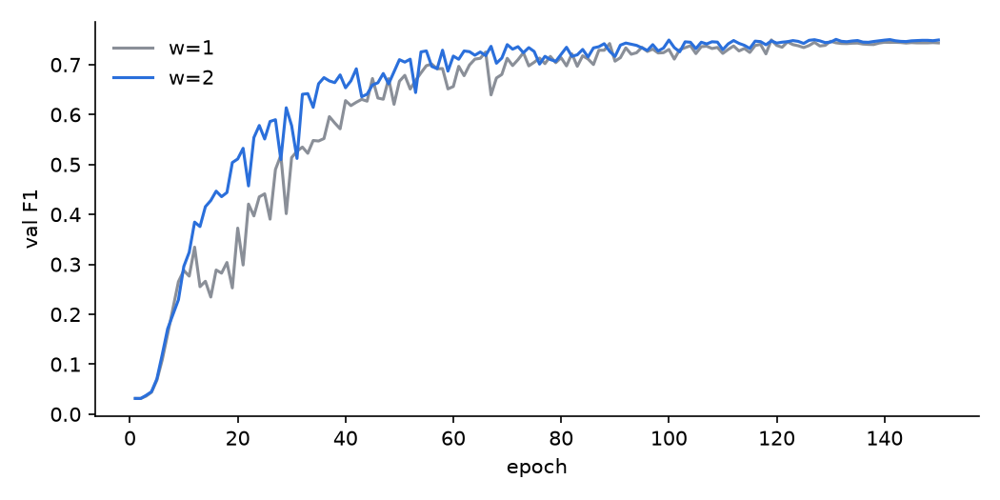
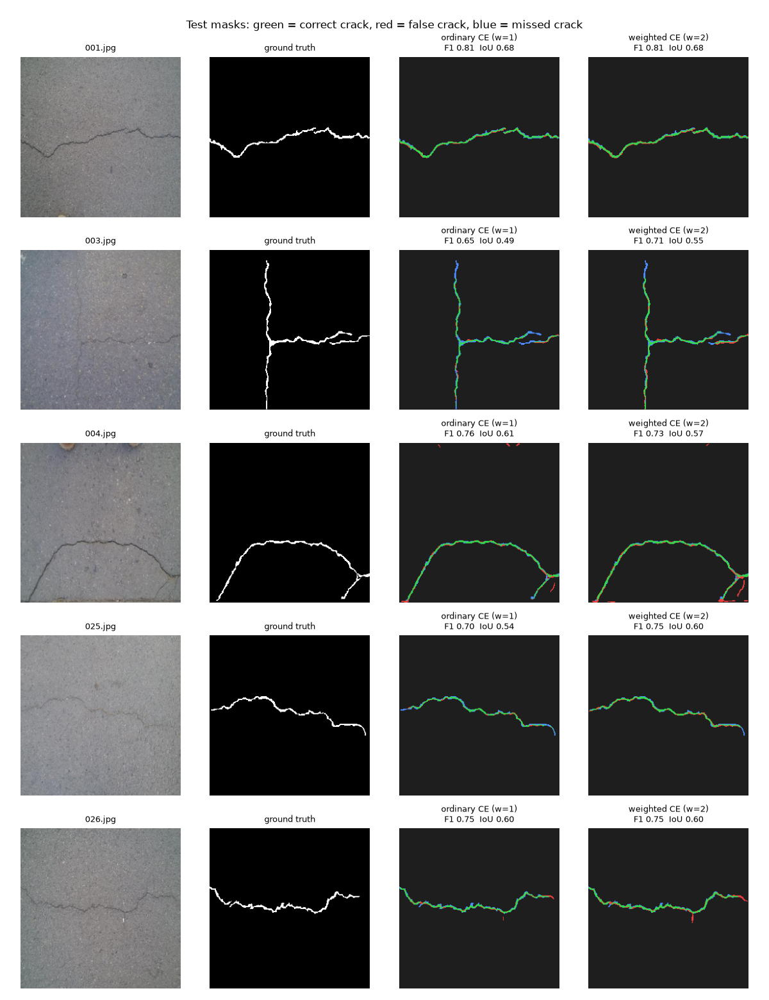

# Crack Segmentation on CrackForest with Weighted Cross-Entropy

**ML Project, Problem Statement 2 (Crack segmentation)** · Roll no. 2403CS01 · U-Net · PyTorch

> **Result in one line.** On the held-out test split, a U-Net trained with weighted cross-entropy (crack weight **w = 2**, chosen on the validation split) improves on the same U-Net trained with ordinary cross-entropy (w = 1) on **F1 from 0.709 to 0.731** and **IoU from 0.549 to 0.576** (mean of 3 seeds). It is better on every seed. Setting the weight back to 1 (the ablation) removes the gain.

---

## Abstract

Pavement cracks are thin structures that cover about 2% of the pixels in a road image. A segmentation network trained with ordinary pixel-wise cross-entropy (CE) spends most of its gradient on the pavement and under-detects cracks: the crack mask comes out broken. We train a standard U-Net on the CrackForest dataset (118 labelled images, resized to 256 × 256, split 82/18/18) and compare ordinary CE with a weighted CE that multiplies the loss on crack pixels by a weight *w*. *w* is chosen from {1, 2, 5, 10, 20, 50} on the validation split, with 3 seeds per value. The best weight, w = 2, raises test recall from 0.656 to 0.766 and F1 from 0.709 to 0.731. The ablation (w = 1) and the sweep show the expected trade-off: large weights (w ≥ 10) find almost every crack pixel but paint cracks too thick, and F1 falls to 0.59 at w = 50. Add-on experiments (Dice term, test-time augmentation) lift test F1 further to 0.737 and IoU to 0.583.

## Table of Contents

1. [Introduction](#1-introduction)
2. [Literature Review](#2-literature-review)
3. [Proposed Methodology](#3-proposed-methodology)
4. [Results and Discussion](#4-results-and-discussion)
5. [Conclusion and Future Scope](#5-conclusion-and-future-scope)
6. [References](#references)
7. [Appendix A: Reproducing the results](#appendix-a-reproducing-the-results)
8. [Appendix B: Repository layout](#appendix-b-repository-layout)

## List of Figures and Tables

| | |
|---|---|
| Figure 1 | Fishbone (cause-and-effect) diagram of thin-crack segmentation failures |
| Figure 2 | EDA: crack-pixel share per image and per split |
| Figure 3 | Sample images and masks at 256 × 256 |
| Figure 4 | End-to-end pipeline (Mermaid) |
| Figure 5 | U-Net architecture (Mermaid) |
| Figure 6 | Validation scores against crack weight *w* |
| Figure 7 | Test precision, recall, F1, IoU: baseline vs proposed |
| Figure 8 | Validation F1 during training |
| Figure 9 | Test masks: baseline vs proposed |
| Table 1 | Dataset summary |
| Table 2 | Training settings shared by every model |
| Table 3 | Weight selection on the validation split |
| Table 4 | Test results: baseline vs weighted CE (main result) |
| Table 5 | Add-on experiments |
| Equation 1 | Weighted cross-entropy |
| Equation 2 | Soft Dice loss |
| Algorithm 1 | Training and weight selection |

---

## 1. Introduction

### 1.1 Background and motivation

Cracks are the earliest visible sign of pavement failure. Manual road surveys are slow and subjective, so automatic crack detection from camera images is widely studied. Pixel-level *segmentation* gives the crack's position, length and width, which drives maintenance decisions. It is harder than ordinary object segmentation, because a crack is a thin, low-contrast line on a textured background with stains, shadows and lane paint.

### 1.2 Problem statement

> Segment the cracks with a U-Net. Compare ordinary cross-entropy with a weighted cross-entropy that counts crack pixels more heavily. Write the weighted loss and choose the weight on the validation split. In one ablation, set the weight back to 1. The weighted loss should improve the test scores.

### 1.3 Objectives

1. Build a clean, reproducible CrackForest pipeline: 256 × 256 resize and a fixed train/validation/test split.
2. Train a U-Net baseline with ordinary cross-entropy.
3. Train the same U-Net with weighted cross-entropy and choose the weight on the validation split only.
4. Report precision, recall, F1 and IoU on the test split for both models, with the ablation w = 1.
5. Explain *why* the weight helps, and where it stops helping.

### 1.4 Scope of the work

Binary segmentation (crack vs pavement) on CrackForest only. One architecture (U-Net) and one change (the loss weight). Everything else is held fixed: split, optimiser, schedule, epochs, augmentation, checkpoint rule and seeds. Add-on experiments are reported separately and do not affect the main comparison.

### 1.5 Contributions

1. **Mask-preserving preprocessing.** CFD masks are resized by area averaging plus a threshold instead of nearest-neighbour, so 1–3 px cracks stay connected after the 480 × 320 → 256 × 256 shrink. We also document the dataset's undocumented labels 3 and 4 and exclude them (Section 3.2).
2. **A validated weight choice.** A 6-value × 3-seed sweep of *w* on the validation split, with the test split untouched until the end. The precision/recall trade-off is plotted (Figure 6).
3. **A controlled comparison and ablation.** The baseline and the proposed model differ only in *w*. Results are mean ± std over 3 seeds, and the improvement holds on every seed.
4. **An honest analysis of what the weight does.** We compare against a baseline whose decision threshold is tuned on validation. Most of weighted CE's gain comes from moving the precision/recall operating point, and w = 2 still wins (Section 4.5).
5. **Extensions and a tested codebase.** Weighted CE + Dice and test-time augmentation reach test F1 0.737 / IoU 0.583. The repository includes unit tests checking the loss against Equation 1, the metrics, and split integrity.

### Figure 1: Why plain CE fails on thin cracks



Weighted CE attacks the **Loss** branch directly. The Dice add-on also targets "no overlap term", and the preprocessing choice targets "nearest resize breaks lines".

---

## 2. Literature Review

### 2.1 Existing approaches

| Family | Representative work | Idea | Limitation for thin cracks |
|---|---|---|---|
| Hand-crafted / classical | Thresholding, edge detectors, minimal paths; **CrackForest** (Shi et al., 2016) | Structured random forests on integral channel features, plus crack descriptors | Hand-designed features break on texture, shadows and low contrast |
| Fully convolutional nets | **FCN** (Long et al., 2015) | Per-pixel classification with an upsampled CNN | Coarse upsampling blurs 1–3 px structures |
| Encoder–decoder with skips | **U-Net** (Ronneberger et al., 2015) | Skip connections return high-resolution detail to the decoder | Trained with plain CE, it is still biased toward the majority class |
| Edge / multi-scale supervision | **HED** (Xie & Tu, 2015); **DeepCrack** (Zou et al., 2019; Liu et al., 2019); **FPHBN** (Yang et al., 2019) | Side outputs at each scale, fused | Heavier models. HED already needed a *class-balanced* CE because edges are rare |
| Loss re-design | Weighted CE / weight maps (Ronneberger et al., 2015); **Dice** (Milletari et al., 2016); **Focal** (Lin et al., 2017); **Generalised Dice** (Sudre et al., 2017); **clDice** (Shit et al., 2021) | Re-balance or replace the per-pixel objective | Need tuning; region losses can be unstable; topology losses add cost |

### 2.2 Research gaps and the reason for the proposed change

* CE sums equal per-pixel terms. With ~48 pavement pixels per crack pixel in our training split, the gradient is dominated by the pavement. The cheapest way to counter this is to re-weight the crack term. That adds one hyper-parameter, no extra parameters, and no change to the network.
* HED set the edge weight from the class ratio (β = |Y⁻|/|Y|). That would give w ≈ 48 here. Section 4 shows this is far too large for an area-segmentation metric: it maximises recall but makes cracks thick. **The weight should be tuned on validation, not set from the ratio.**
* Many crack papers report only tolerance-based F1, on differing splits. We report strict pixel metrics (as the assignment asks), plus a 2-px-tolerance F1 for context.

---

## 3. Proposed Methodology

### 3.1 Dataset description

**CrackForest (CFD)**, from [github.com/cuilimeng/CrackForest-dataset](https://github.com/cuilimeng/CrackForest-dataset). The images are 480 × 320 RGB photographs of urban road surfaces taken with a phone camera.

**Table 1: Dataset summary**

| Item | Value |
|---|---|
| Images in repository | 156 (`image/*.jpg`) |
| Images with ground truth (used) | **118** (`groundTruth/*.mat`, 001–118) |
| Original size | 480 × 320 |
| Crack pixels (original) | 1.62 % |
| Crack pixels (256 × 256) | 1.91 % (min 0.47 %, max 7.85 % per image) |
| Pavement : crack ratio (train) | 48 : 1 |
| Split (seed 42) | **82 train / 18 val / 18 test** (≈ 70/15/15) |

### 3.2 Data preprocessing

* **Mask decoding.** Each `.mat` file holds `groundTruth.Segmentation`, where 1 = pavement and 2 = crack. 22 masks also contain label 3, which fills whole pavement blocks enclosed by a crack network (up to 45k px in 093/097/101). 5 masks contain label 4, a rare thin-line label (~1.3k px over the whole dataset). Neither is a crack line, so **crack = label 2**.
* **Resize to 256 × 256.** Images use bilinear interpolation. Masks use **area averaging, then a threshold of 0.25**. Nearest-neighbour would skip whole pixel columns and break 1–3 px cracks into dashes.
* **Normalisation.** ImageNet mean/std per channel.
* **Augmentation (train only, identical for every model).** Random horizontal flip, vertical flip, and 90° rotation. These are exact pixel permutations, so the thin masks are never interpolated.
* **Split.** Random permutation with seed 42, saved in [`data/split.json`](data/split.json). The same split is used for every model. A unit test checks the three sets are disjoint and cover all 118 images.

### 3.3 Exploratory data analysis



*Figure 2: Crack share per image. Every image is ≥ 92 % pavement. The heavy tail (dense crack networks, > 4 %) falls in the training split, so val and test are slightly sparser (1.60 % / 1.71 % vs 2.02 %).*



*Figure 3: Samples from sparse to dense cracks. The cracks are thin, dark, and low in contrast against textured asphalt with stains.*

**What the EDA implies.** The imbalance is extreme, and its scale (≈ 1 : 48) is what makes CE under-weight cracks. Masks usually contain one connected crack (median 1 component), so broken predictions are visible errors.

### 3.4 Proposed model architecture

**Figure 4: Pipeline**



**Figure 5: U-Net (7.76 M parameters, base width 32)**



DoubleConv = (3×3 conv → BatchNorm → ReLU) × 2. Code: [`src/model.py`](src/model.py).

### 3.5 Loss functions

Let *pᵢ* = σ(*zᵢ*) be the predicted crack probability of pixel *i*, *yᵢ* ∈ {0, 1} the label, and *N* the number of pixels in the batch.

**Equation 1: Weighted cross-entropy (proposed)**

$$
\mathcal{L}_{wCE} = -\frac{1}{N}\sum_{i=1}^{N}\Big[\,w\,y_i\log p_i + (1-y_i)\log(1-p_i)\Big],\qquad w \ge 1
$$

* **w = 1** is ordinary cross-entropy: the baseline, and the ablation. With one logit, binary CE equals 2-class softmax CE; a unit test checks this.
* With **w > 1**, every missed crack pixel costs *w* times more. The minimiser of the expected loss becomes p* = w·P(crack) / (w·P(crack) + 1 − P(crack)). In effect, the 0.5 decision boundary moves from P(crack) = 0.5 to P(crack) = 1/(1 + w). That trades precision for recall.
* **Why this loss.** It directly counters the 48 : 1 imbalance, adds no parameters, keeps CE's stable per-pixel gradients, and has a single interpretable knob.

**Equation 2: Soft Dice (add-on only)**

$$
\mathcal{L}_{Dice} = 1-\frac{2\sum_i p_i y_i + \epsilon}{\sum_i p_i + \sum_i y_i + \epsilon},\qquad \mathcal{L}_{add\text{-}on} = \mathcal{L}_{wCE} + \mathcal{L}_{Dice}
$$

Code: [`src/losses.py`](src/losses.py).

### 3.6 Algorithm

**Algorithm 1: Training and weight selection**

```text
Input: split (train 82 / val 18 / test 18), grid W = {1, 2, 5, 10, 20, 50}, seeds S = {0, 1, 2}
for w in W:
    for s in S:
        seed everything with s; init U-Net
        for epoch = 1..150:
            for each mini-batch (8 images, flip/rot90 aug) of train:
                minimise L_wCE(w) with AdamW, OneCycle LR (max 1e-3), AMP
            compute val F1 at threshold 0.5; keep weights with best val F1
        record val and test scores of the kept weights
w* = argmax_w  mean_s val_F1(w, s)          # test scores are NOT used here
Report test scores of w = 1 (baseline / ablation) and w = w*, mean ± std over S
```

### 3.7 Experimental setup

**Table 2: Settings shared by every model**

| Setting | Value |
|---|---|
| Network | U-Net, base 32, BatchNorm, 7.76 M params, random init |
| Input | 256 × 256 RGB, ImageNet normalisation |
| Optimiser | AdamW, weight decay 1e-4 |
| LR schedule | OneCycle, max LR 1e-3 |
| Batch / epochs | 8 / 150 (10 steps per epoch) |
| Augmentation | h-flip, v-flip, rot90 (train only) |
| Checkpoint | Epoch with best validation F1 (threshold 0.5) |
| Threshold | 0.5 for all models in the main comparison |
| Seeds | 0, 1, 2 (all randomness seeded; cuDNN deterministic) |
| Precision | Mixed (fp16 autocast), loss in fp32 |
| Hardware | NVIDIA RTX 4060 Laptop (8 GB), ~2.5 min per run |

**Hyper-parameter tuning.** The tuned hyper-parameter is the crack weight *w*: 6 values × 3 seeds = 18 runs, selected on the validation split. The checkpoint epoch is also chosen on validation.

---

## 4. Results and Discussion

### 4.1 Performance evaluation metrics

All metrics are computed over **every pixel of the split** (micro-averaged), with crack as the positive class.

* **Precision** = TP / (TP + FP): of the pixels predicted as crack, the fraction that are crack.
* **Recall** = TP / (TP + FN): of the true crack pixels, the fraction found.
* **F1** = 2PR / (P + R): the harmonic mean, which is equal to Dice.
* **IoU** = TP / (TP + FP + FN): overlap divided by union.
* **F1 (2-px tol.)** is reported for context only. A prediction counts as correct if within 2 px of a true crack pixel, the convention in the crack literature (CrackForest, DeepCrack), because hand-drawn 1–3 px masks are themselves uncertain by about a pixel.

Code and unit tests: [`src/metrics.py`](src/metrics.py), [`tests/test_core.py`](tests/test_core.py).

### 4.2 Weight selection (validation split)

**Table 3: Validation scores, mean ± std over 3 seeds**

| w | Precision | Recall | F1 | IoU | F1 (2-px tol.) |
|---|---|---|---|---|---|
| 1 | 0.778 ± 0.001 | 0.713 ± 0.007 | 0.744 ± 0.004 | 0.593 ± 0.005 | 0.946 ± 0.003 |
| **2 (w\*)** | 0.713 ± 0.013 | 0.809 ± 0.009 | **0.758 ± 0.005** | **0.610 ± 0.006** | **0.956 ± 0.005** |
| 5 | 0.646 ± 0.016 | 0.856 ± 0.024 | 0.736 ± 0.003 | 0.582 ± 0.004 | 0.953 ± 0.004 |
| 10 | 0.583 ± 0.015 | 0.897 ± 0.020 | 0.706 ± 0.005 | 0.546 ± 0.006 | 0.938 ± 0.008 |
| 20 | 0.504 ± 0.005 | 0.938 ± 0.002 | 0.656 ± 0.004 | 0.488 ± 0.005 | 0.932 ± 0.002 |
| 50 | 0.431 ± 0.009 | 0.949 ± 0.013 | 0.593 ± 0.006 | 0.421 ± 0.006 | 0.892 ± 0.004 |



*Figure 6: As w grows, recall rises monotonically and precision falls. F1 and IoU peak at w = 2. The class-ratio weight (w ≈ 48) is near the worst setting.*

### 4.3 Main result: test split

**Table 4: Test scores, mean ± std over 3 seeds (threshold 0.5)**

| Model | Precision | Recall | F1 | IoU | F1 (2-px tol.) |
|---|---|---|---|---|---|
| Baseline: ordinary CE (w = 1) = ablation | **0.772** ± 0.001 | 0.656 ± 0.009 | 0.709 ± 0.005 | 0.549 ± 0.007 | 0.929 ± 0.002 |
| **Proposed: weighted CE (w = 2)** | 0.699 ± 0.005 | **0.766** ± 0.004 | **0.731** ± 0.001 | **0.576** ± 0.001 | **0.943** ± 0.001 |
| Change | −0.073 | **+0.110** | **+0.022** | **+0.027** | +0.014 |

Per seed (test F1 / IoU): seed 0: 0.714 / 0.555 → **0.730 / 0.574**; seed 1: 0.701 / 0.540 → **0.731 / 0.576**; seed 2: 0.711 / 0.552 → **0.732 / 0.578**. The gain holds on all three seeds, and the seed-to-seed spread of the proposed model is 5× smaller.



*Figure 7: Test scores. Weighted CE trades 7 points of precision for 11 points of recall, a net gain in F1 and IoU.*

### 4.4 Graphical analysis



*Figure 8: Validation F1 during training (seed 0). The weighted model learns cracks much faster (val F1 ≈ 0.6 by epoch 30, versus ≈ 0.5 for w = 1), because missed crack pixels give it a 2× larger gradient. The curves converge after about epoch 90, with w = 2 slightly ahead.*



*Figure 9: The first five test images by file name, not cherry-picked. Green = correct crack, red = false crack, blue = missed crack.*

**Reading the test masks.**
* **003:** both models miss the faint top of the vertical crack. The baseline also leaves gaps in the vertical crack and the right-hand branch (blue), which w = 2 fills in (F1 0.65 → 0.71). This is the "broken crack" failure the assignment describes.
* **025:** the baseline drops both ends of the crack. Weighted CE extends the line (0.70 → 0.75).
* **001, 026:** easy, high-contrast cracks; both models are equal.
* **004:** the one case where the baseline is better (0.76 vs 0.73). Weighted CE adds false positives (red) at the bottom image border and around the crack junction on the right. This is the cost of the higher recall: *w* pushes the model toward "crack" on dark linear texture.
* Most red pixels sit *beside* green ones: predicted cracks are about 1 px wider than the annotation. That is why the 2-px-tolerant F1 is much higher (0.94) than the strict F1 (0.73). With w ≥ 10 the widening grows, which is the "too thick" failure (precision 0.43 at w = 50).

### 4.5 Discussion of findings

1. **The weighted loss works for the stated reason.** Re-weighting crack pixels raises recall from 0.656 to 0.766, so fewer crack segments are missed, and F1/IoU rise.
2. **A small weight is enough.** The F1-optimal weight (2) is about 25× smaller than the class ratio (48). The 1 : 48 imbalance is counted over *pixels*, but most pavement pixels are easy and contribute almost no loss after early training. The effective imbalance among *hard* pixels near the crack is far smaller.
3. **Weighted CE ≈ a shifted operating point.** From Equation 1, w moves the decision boundary to P(crack) = 1/(1 + w). As a control, we tuned the baseline's threshold on validation (Table 5). That recovers most of the gap (F1 0.725), but w = 2 still wins (0.731) with a lower variance. Training with the weight also changes what the network learns, not just where it is cut.
4. **The precision drop is mostly ±1 px width.** Strict pixel metrics penalise a 1-px offset on a 2-px crack heavily. The tolerant F1 shows that both models locate cracks well (> 0.93).

### 4.6 Add-on: improving the model further (beyond the assignment)

**Table 5: Add-on experiments, test split, mean ± std over 3 seeds**

| Model | Precision | Recall | F1 | IoU | F1 (2-px tol.) |
|---|---|---|---|---|---|
| Baseline: ordinary CE (w = 1) | 0.772 ± 0.001 | 0.656 ± 0.009 | 0.709 ± 0.005 | 0.549 ± 0.007 | 0.929 ± 0.002 |
| Proposed: weighted CE (w = 2) | 0.699 ± 0.005 | 0.766 ± 0.004 | 0.731 ± 0.001 | 0.576 ± 0.001 | 0.943 ± 0.001 |
| Ordinary CE + threshold tuned on val | 0.727 ± 0.002 | 0.723 ± 0.007 | 0.725 ± 0.004 | 0.568 ± 0.005 | 0.933 ± 0.002 |
| Weighted CE (w = 2) + threshold tuned on val | 0.714 ± 0.008 | 0.748 ± 0.009 | 0.730 ± 0.001 | 0.575 ± 0.001 | 0.943 ± 0.001 |
| Weighted CE (w = 2) + 8× flip/rot TTA | 0.706 ± 0.004 | 0.766 ± 0.004 | 0.734 ± 0.001 | 0.580 ± 0.001 | 0.946 ± 0.001 |
| CE + Dice (w = 1) | 0.726 ± 0.001 | 0.733 ± 0.004 | 0.729 ± 0.002 | 0.574 ± 0.002 | 0.940 ± 0.004 |
| Weighted CE + Dice (w = 2) | 0.712 ± 0.002 | 0.760 ± 0.005 | 0.735 ± 0.002 | 0.582 ± 0.002 | 0.946 ± 0.002 |
| **Weighted CE + Dice (w = 2) + TTA** | 0.714 ± 0.003 | 0.761 ± 0.006 | **0.737 ± 0.001** | **0.583 ± 0.001** | **0.948 ± 0.000** |

* **Dice term.** It adds a whole-mask overlap score that is immune to imbalance. On its own (w = 1) it gives most of the weighting's gain. Combined with w = 2, it is the best single model (F1 0.735).
* **Test-time augmentation.** Averaging the 8 flip/rotation views costs no training and adds +0.002 to +0.004 F1 consistently.
* **Threshold tuning** helps the baseline a lot, but not the weighted model. w = 2 is already near the best operating point, which supports finding 3 above.

### 4.7 Comparison with existing models

Published CFD results (CrackForest [2], DeepCrack [5, 6], FPHBN [7]) use full resolution, different splits, and **tolerance-based** precision/recall (2–5 px). They are not directly comparable with the strict 256 × 256 pixel metrics this assignment requires, so we make no ranking claim. For orientation only, our 2-px-tolerance F1 is 0.943 (weighted CE) and 0.948 (with Dice and TTA). The gap between our tolerant and strict F1 (0.94 vs 0.73) shows that the remaining error is mostly ±1 px crack width, not missed or invented cracks.

---

## 5. Conclusion and Future Scope

### 5.1 Key findings

* Weighted cross-entropy with w = 2 improves every headline test metric except precision: F1 +0.022, IoU +0.027, recall +0.110. This holds on all 3 seeds. Setting w back to 1 removes the gain.
* *w* must be **tuned**. Larger weights monotonically raise recall and lower precision. The class-ratio heuristic (w ≈ 48; w = 50 tested) costs about 0.16 validation F1.
* Weighted CE mostly moves the precision/recall operating point. Training with it still beats a threshold-tuned CE baseline.
* Adding a Dice term and TTA gives the best result: test F1 0.737, IoU 0.583.

### 5.2 Limitations

* **Small test set.** 18 images (~1.2 M pixels, ~20k crack pixels). Differences under ~0.01 F1 should be treated with care; we report 3 seeds for this reason.
* **One split.** k-fold cross-validation would give a tighter estimate, but it is not the assignment's protocol.
* **Downsampling.** 256 × 256 thins cracks to 1–2 px, so the strict metrics are dominated by ±1 px boundary errors.
* **Annotation noise.** The hand-drawn masks have a ~1 px width uncertainty. Labels 3 and 4 are undocumented and were excluded by inspection.

### 5.3 Future research directions: how to improve the model further

Ranked by expected gain for effort:

1. **Pre-trained encoder** (ResNet-34 / EfficientNet U-Net on ImageNet). With only 82 training images, pre-trained features usually give the largest single jump.
2. **Topology-aware loss.** clDice [11] or skeleton-recall terms score the crack's centreline, which directly targets *broken* cracks without rewarding thick ones.
3. **Train at native resolution with random 256 × 256 crops** instead of shrinking the whole image. Cracks keep their true 2–4 px width, and boundary errors matter less.
4. **Boundary-distance weight maps** (as in the original U-Net) instead of one global *w*. They weight pavement pixels *next to* cracks, which reduces the thick-crack false positives.
5. **Focal or Tversky loss** to focus on hard pixels and tune the FP/FN balance explicitly.
6. **Deep supervision / multi-scale side outputs** (HED, DeepCrack style) for faint cracks.
7. **More data.** Pre-train on larger crack sets (CRACK500, DeepCrack, CrackTree260) and fine-tune on CFD.
8. **Post-processing.** Remove small connected components and apply morphological thinning to the annotation width.
9. **Evaluation.** 5-fold cross-validation and per-image confidence intervals.

---

## References

1. O. Ronneberger, P. Fischer, T. Brox. *U-Net: Convolutional Networks for Biomedical Image Segmentation.* MICCAI, 2015.
2. Y. Shi, L. Cui, Z. Qi, F. Meng, Z. Chen. *Automatic Road Crack Detection Using Random Structured Forests.* IEEE T-ITS 17(12), 2016.
3. L. Cui, Z. Qi, Z. Chen, F. Meng, Y. Shi. *Pavement Distress Detection Using Random Decision Forests.* ICDS, 2015.
4. J. Long, E. Shelhamer, T. Darrell. *Fully Convolutional Networks for Semantic Segmentation.* CVPR, 2015.
5. Q. Zou, Z. Zhang, Q. Li, X. Qi, Q. Wang, S. Wang. *DeepCrack: Learning Hierarchical Convolutional Features for Crack Detection.* IEEE TIP 28(3), 2019.
6. Y. Liu, J. Yao, X. Lu, R. Xie, L. Li. *DeepCrack: A Deep Hierarchical Feature Learning Architecture for Crack Segmentation.* Neurocomputing 338, 2019.
7. F. Yang, L. Zhang, S. Yu, D. Prokhorov, X. Mei, H. Ling. *Feature Pyramid and Hierarchical Boosting Network for Pavement Crack Detection.* IEEE T-ITS, 2019.
8. S. Xie, Z. Tu. *Holistically-Nested Edge Detection.* ICCV, 2015.
9. F. Milletari, N. Navab, S.-A. Ahmadi. *V-Net: Fully Convolutional Neural Networks for Volumetric Medical Image Segmentation.* 3DV, 2016.
10. T.-Y. Lin, P. Goyal, R. Girshick, K. He, P. Dollár. *Focal Loss for Dense Object Detection.* ICCV, 2017.
11. S. Shit et al. *clDice: A Novel Topology-Preserving Loss Function for Tubular Structure Segmentation.* CVPR, 2021.
12. C. H. Sudre, W. Li, T. Vercauteren, S. Ourselin, M. J. Cardoso. *Generalised Dice Overlap as a Deep Learning Loss Function for Highly Unbalanced Segmentations.* DLMIA, 2017.
13. I. Loshchilov, F. Hutter. *Decoupled Weight Decay Regularization.* ICLR, 2019.

---

## Appendix A: Reproducing the results

```bash
# 1. environment (Python 3.10+; pick the CUDA build that matches your GPU)
python -m venv .venv && source .venv/bin/activate      # Windows: .venv\Scripts\activate
pip install torch torchvision --index-url https://download.pytorch.org/whl/cu126
pip install -r requirements.txt

# 2. data
git clone --depth 1 https://github.com/cuilimeng/CrackForest-dataset.git data/raw/CFD
python scripts/prepare_data.py          # -> data/cfd256.npz, data/split.json, data/dataset_stats.json

# 3. checks (loss formula, metrics, split integrity)
python -m pytest -q tests

# 4. experiments: 18 sweep runs + 6 add-on runs, ~1 h on an RTX 4060, resumable
python scripts/run_experiments.py 150

# 5. tables + figures
python scripts/make_eda.py
python scripts/make_report.py           # -> results/results.md, results/figures/*.png

# single run, e.g. the proposed model
python -m src.train --w 2 --seed 0
```

Per-run outputs live in `results/runs/<loss>_w<w>_s<seed>/`: `metrics.json` (val/test, with and without TTA) and `history.json` (per-epoch loss and val F1). The `probs.npz` probability maps (153 MB in total) are not committed; step 4 regenerates them.

## Appendix B: Repository layout

```text
src/
  model.py        U-Net
  losses.py       weighted CE (Eq. 1), soft Dice (Eq. 2)
  metrics.py      precision / recall / F1 / IoU, 2-px tolerant F1
  data.py         dataset + flip/rot90 augmentation
  train.py        one training run (seeded, AMP, best-val-F1 checkpoint, TTA eval)
scripts/
  prepare_data.py decode .mat masks, resize to 256, fixed split
  run_experiments.py  weight sweep -> w*, add-on runs
  make_report.py  tables (results/results.md) + figures
  make_eda.py     EDA figures + fishbone diagram
tests/test_core.py  unit tests
data/split.json     the fixed split (stems per set)
results/            results.md, summary.json, selection.json, figures/, runs/*/metrics.json
```
